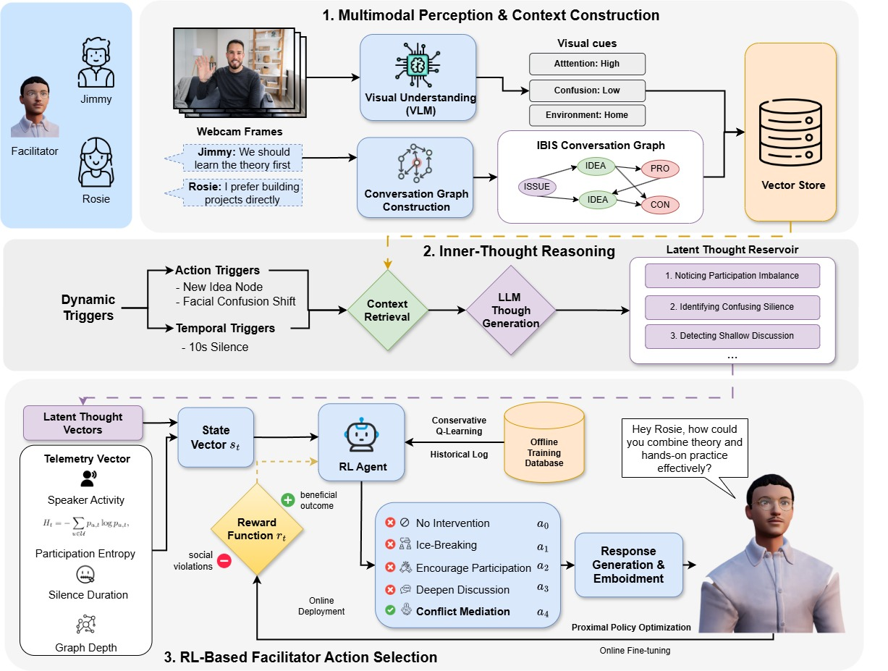

# Proactive Virtual Facilitator

This repository contains an early-stage prototype of an interactive 3D AI virtual agent, developed as part of the research for the workshop paper:

> **[When and How Should the Agent Intervene? Designing an RL-Driven Multimodal Virtual Agent for Proactive Facilitation](./ASIMOV_2026%20%283%29.pdf)**

### Publication
This paper was accepted at **ASIMOV 2026** (Workshop on Adaptive Social Interaction based on user’s Mental mOdels and behaVior in HRI), held in conjunction with **The 18th International Conference on Social Robotics + Art**, 1-4 July, 2026, London (UK).

## System Framework



The system architecture is divided into a React/Vite frontend (for the 3D web-based interface) and a FastAPI/Python backend (handling the core logic, text-to-speech, and communication).

---

## Prerequisites

- **Node.js & npm** (for the frontend environment)
- **Python 3.8+** (for the backend environment)
- **FFmpeg & Rhubarb Lip Sync**: Ensure these are correctly configured or placed in the `back/bin` directory if required by your setup.

## Installation & Setup

### 1. Clone the Repository

```bash
git clone <your-repo-url>
cd Virtual-Agent-for-Proactive-Facilitation
```

### 2. Backend Setup

The backend handles the AI logic, text-to-speech generation, and audio processing.

```bash
# Navigate to the backend directory
cd back

# Create and activate a virtual environment (Recommended)
python -m venv venv
# On Windows: venv\Scripts\activate
# On Mac/Linux: source venv/bin/activate

# Install required dependencies
pip install -r requirements.txt
```

#### Environment Variables
Create an `.env` file in the `back` directory. An example configuration is provided:
```bash
cp .env.example .env
```
Edit the `.env` file to include your actual `OPENAI_API_KEY`.

#### Run the Backend
```bash
# Ensure you are in the `back` folder and the virtual environment is active
python main.py
```
The backend API and WebSockets will start, typically on port `3000`.

### 3. Frontend Setup

The frontend provides the 3D collaborative environment for the Avatar using React and React Three Fiber.

Open a new terminal window:
```bash
# Navigate to the frontend directory
cd front

# Install dependencies
npm install

# Start the development server
npm run dev
```
The application will launch on your local development server (usually `http://localhost:5173`).

## Project Structure & Version Control

- **Environment Variables**: All `.env` files are ignored to protect sensitive API keys.
- **Certificates**: Local SSL certificates (`front/certs/`) are excluded from version control.
- **Generated Media**: Temporary generated speech audio files (`back/audios/message_*`) are ignored.
- **Dependencies**: `node_modules`, `__pycache__`, and virtual environments (`venv`, `.venv`) are correctly excluded to keep the repository clean.
